# Capstone Assignment: FinSecure Pay
### Done by: Thong Jing Yuan

## Task 1: Application Development and Version Control

### Steps:

1. Create a Spring Boot application using Java 17 and Maven. The application provides a `/health` endpoint and a `/validate` endpoint for validating payment transactions.

2. Add validation rules for the transaction ID, amount, currency, source account, and destination account. Test both accepted and rejected transactions successfully.

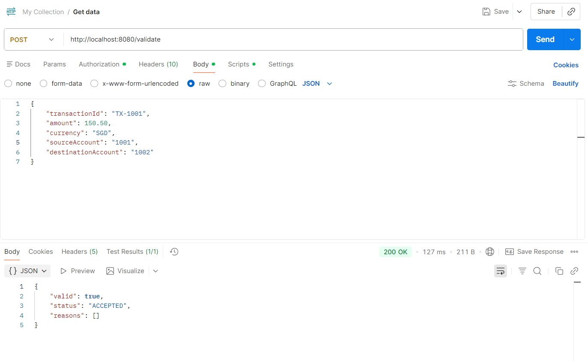

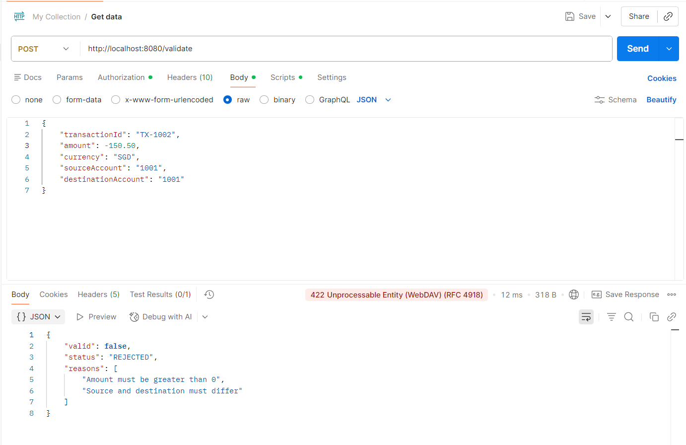

3. Add JUnit 5 tests for the validation service and controller. Build and test the application using:

```powershell
.\mvnw.cmd clean test
```

The tests and Maven build complete successfully.

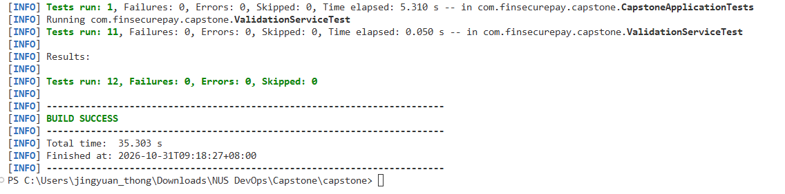

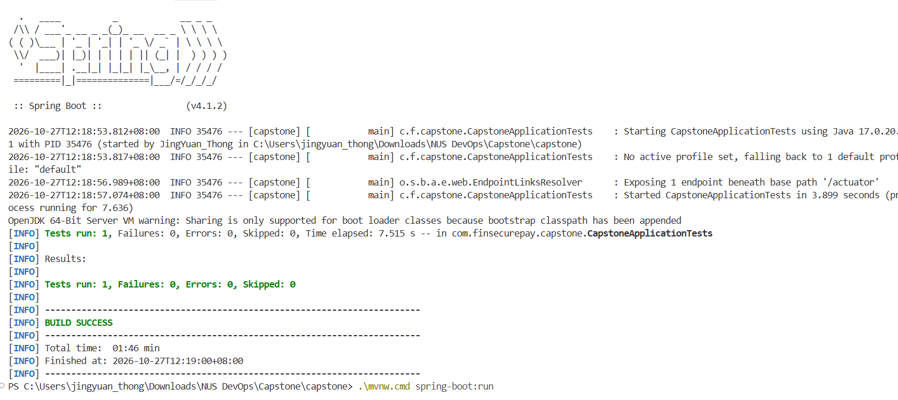

4. Run the application locally using:

```powershell
.\mvnw.cmd spring-boot:run
```

The `/health` endpoint returns a successful response.

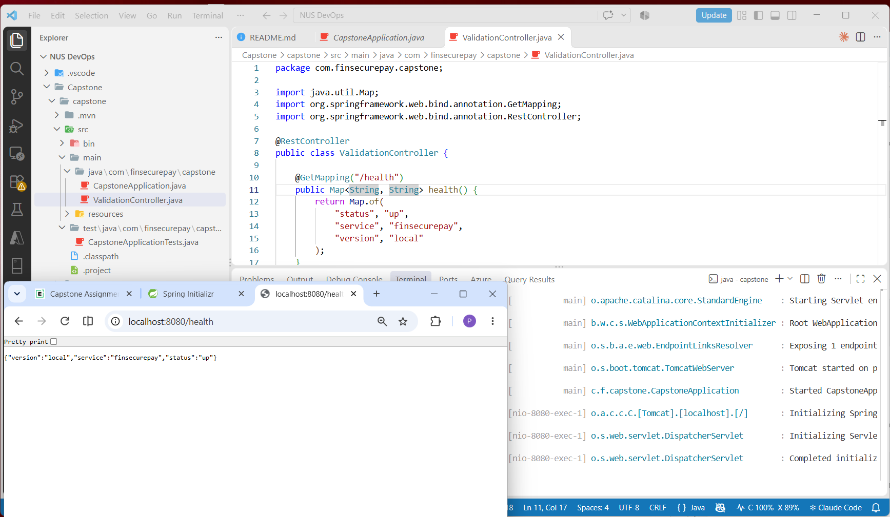

## Task 2: Containerisation

### Steps:

1. Create a multi-stage Dockerfile. Maven and Eclipse Temurin 17 build the application, while Eclipse Temurin 17 JRE runs the final container.

2. Build and tag the first application image as `v1.0.0` using:

```powershell
docker build -t tjysats/nus-devops-capstone-finsecurepay:v1.0.0 .
```

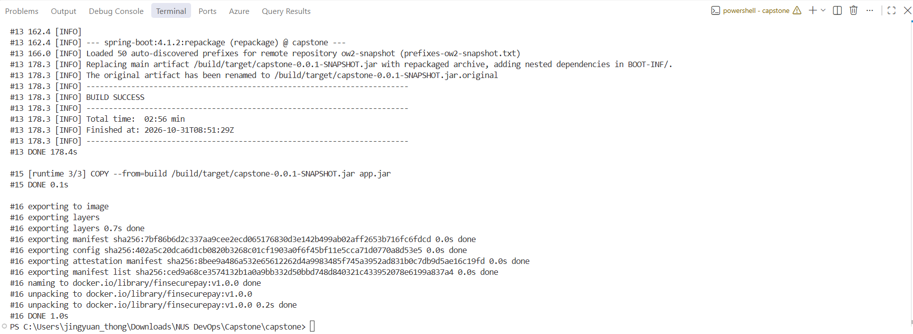

3. Run the image locally and map container port `8080` to the host:

```powershell
docker run -d --name finsecurepay -p 8080:8080 tjysats/nus-devops-capstone-finsecurepay:v1.0.0
```

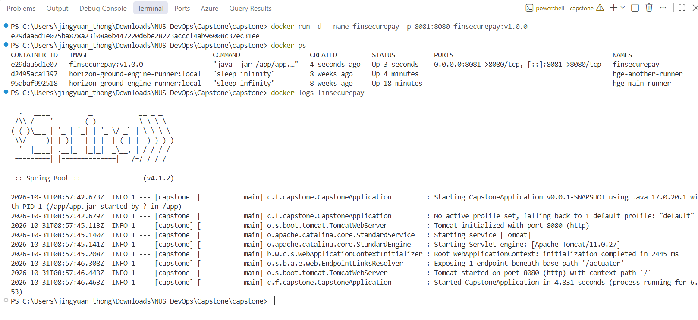

4. Test the health and transaction validation endpoints through the running container.

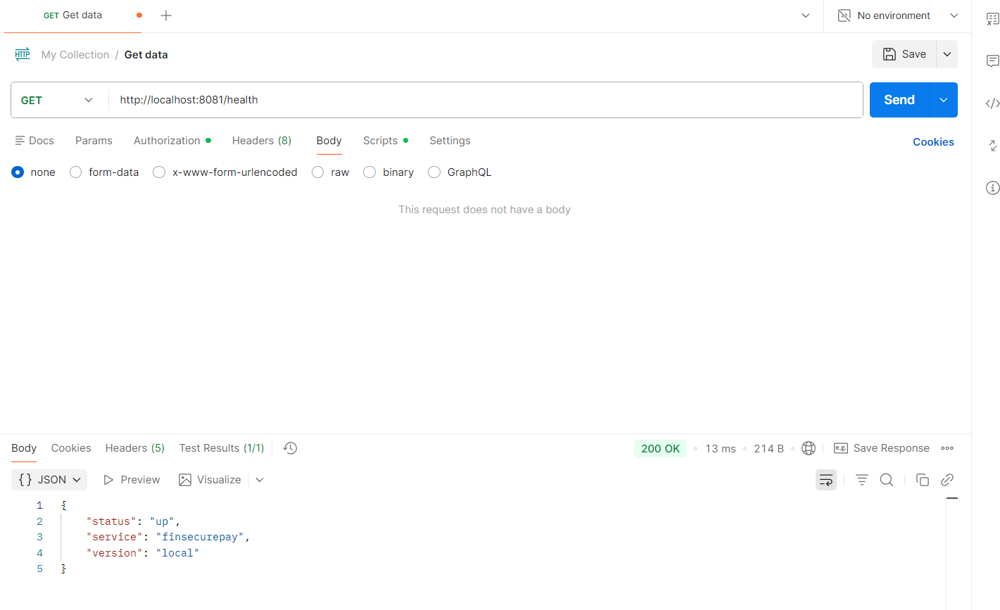

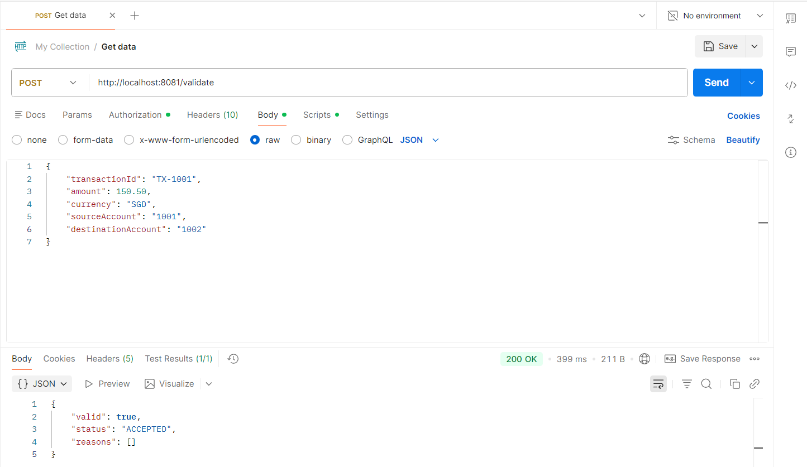

5. Push the versioned image to Docker Hub using:

```powershell
docker push tjysats/nus-devops-capstone-finsecurepay:v1.0.0
```

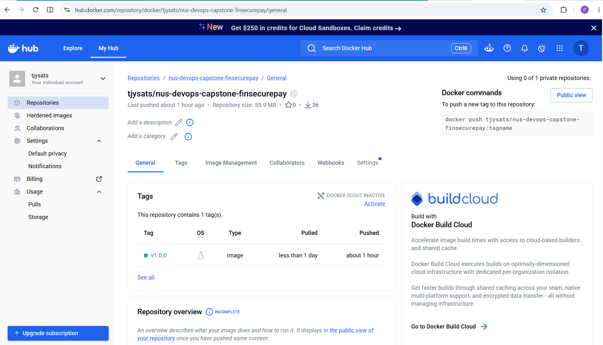

## Task 3: Kubernetes and Cloud Deployment

### Steps:

1. Create `k8s/finsecurepay.yaml` containing the following Kubernetes resources:
   - Namespace `finsecurepay`
   - ConfigMap for application configuration
   - Deployment with two replicas
   - Readiness and liveness probes
   - LoadBalancer Service for external access

2. First apply the manifest to Docker Desktop Kubernetes to verify that both application pods start successfully.

```powershell
kubectl apply -f k8s/finsecurepay.yaml
kubectl rollout status deployment/finsecurepay -n finsecurepay
kubectl get all -n finsecurepay
```

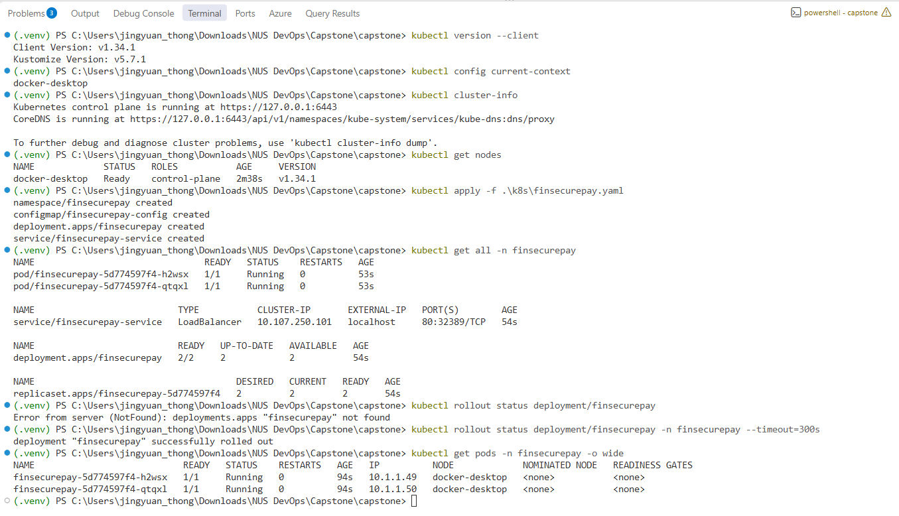

3. Create an Amazon EKS cluster in the Singapore region with two managed worker nodes.

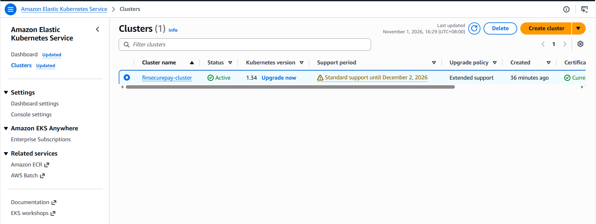

4. Update the kubeconfig for the EKS cluster, then apply the same Kubernetes manifest. Both replicas complete their rollout and the LoadBalancer Service receives an external address.

```powershell
aws eks update-kubeconfig --region ap-southeast-1 --name finsecurepay-cluster
kubectl apply -f k8s/finsecurepay.yaml
kubectl rollout status deployment/finsecurepay -n finsecurepay --timeout=300s
kubectl get all -n finsecurepay
```

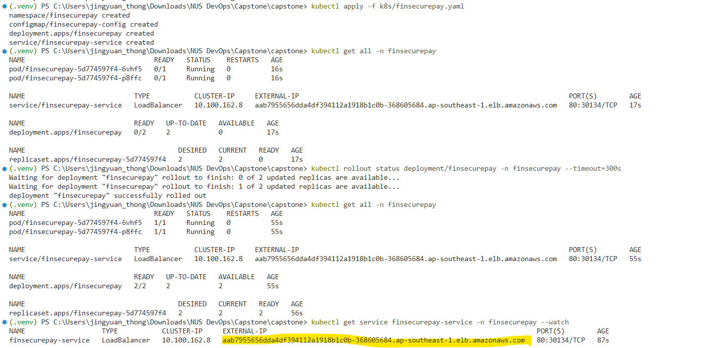

5. Verify external access through the LoadBalancer. The application health, readiness, and liveness endpoints return successful responses.

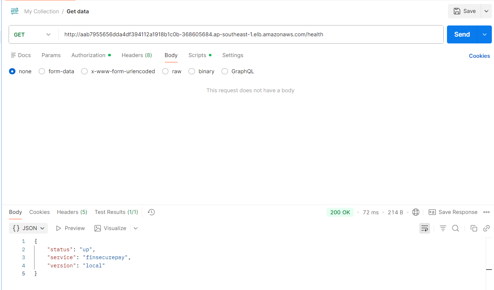


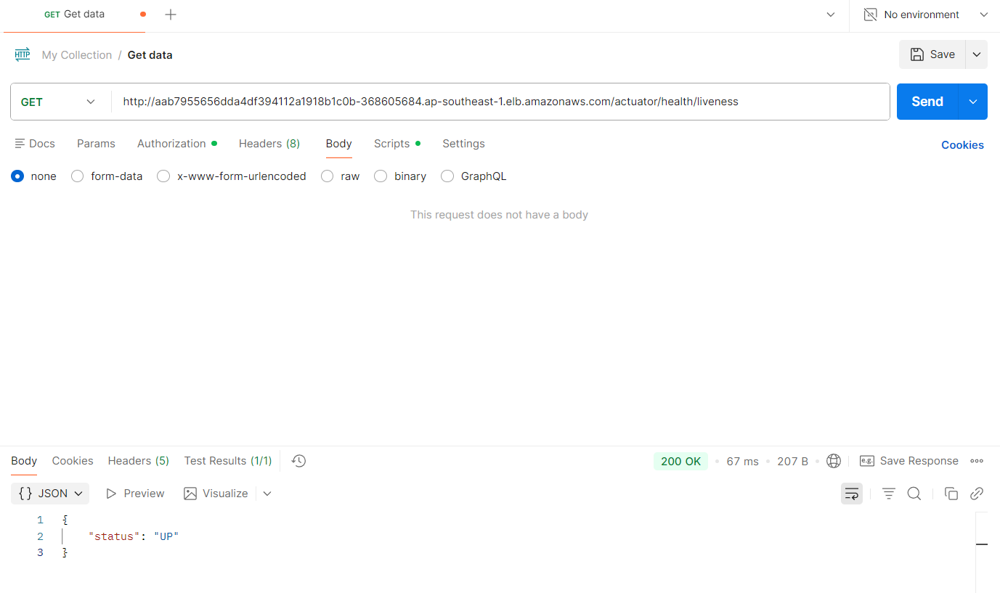

6. Test both successful and rejected payment transactions through the externally accessible application.

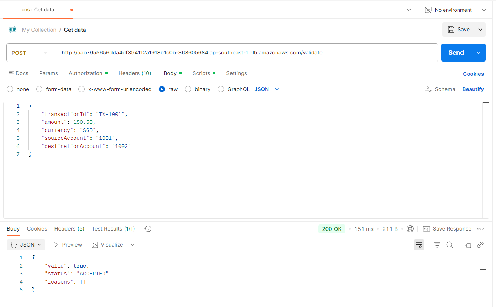

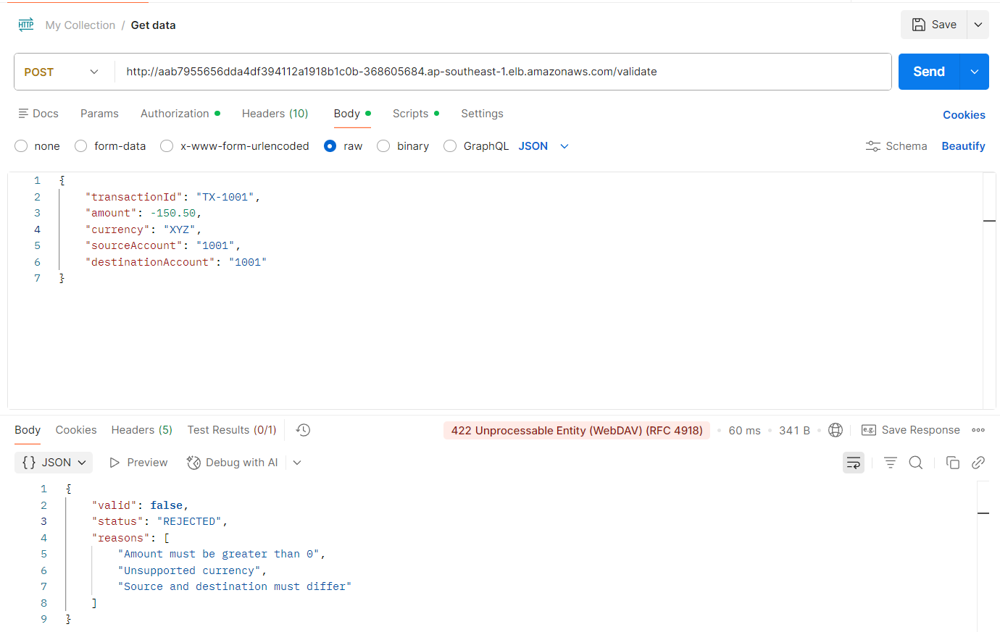

7. Delete one application pod and verify that the Deployment automatically creates a replacement pod while maintaining two replicas.

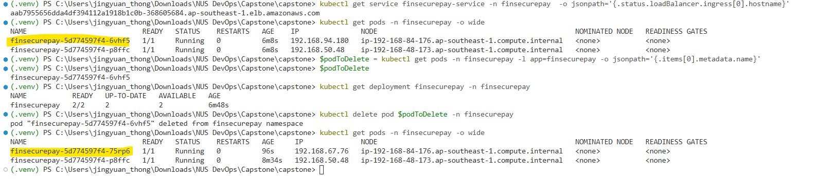
